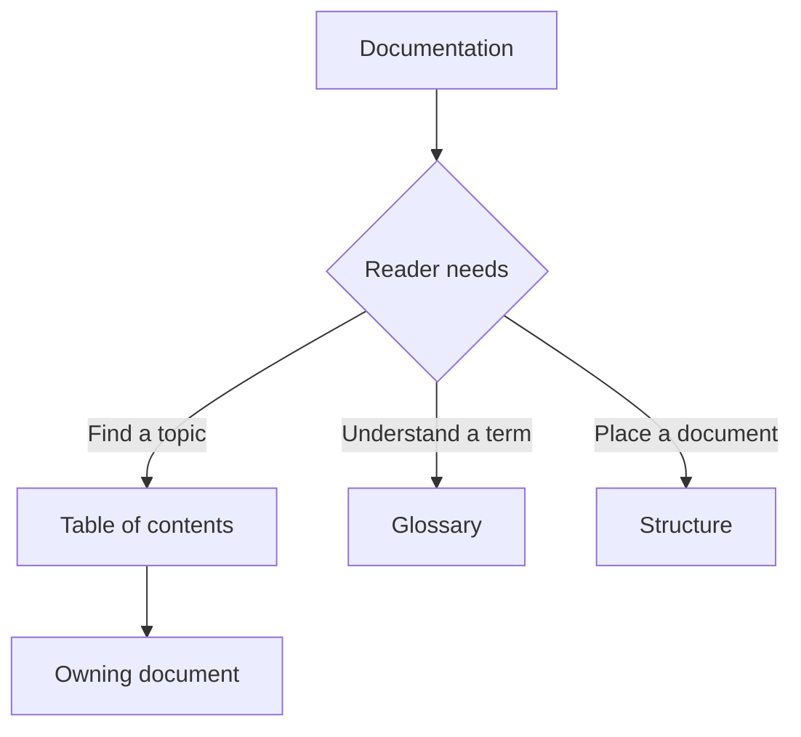

# Documentation

## Rules

- Write for the role using the document. Keep entry pages brief; place necessary detail in the owning topic.
- Centralize document titles and subtitles in the [table of contents](table_of_content.md). Link to its relevant section instead of maintaining duplicate document lists ([DRY [28]](glossary.md#28-dry)).
- Centralize jargon definitions in the [glossary](glossary.md), grouped by concern. Give each entry a stable number; link the first prose use of a term in each document to its numbered entry, for example [JO [1]](glossary.md#1-jo). Do not repeat definitions across documents (DRY).
- Keep rules and redirections here, directory layout in [structure](structure.md), navigation in the table of contents, terminology in the glossary, and operational details in their owning topics ([SoC [29]](glossary.md#29-soc)).
- Add Mermaid diagrams when documenting flows and handoffs. Prefer `flowchart TD` so readers follow the sequence from top to bottom. Preserve unknown branches and evidence qualifications.
- Keep draft and discovery status visible. Reported practice is not an approved operating procedure.
- Follow the [documentation maintenance SOP](../SOP.md) for review. Assign a process owner and approver before adopting a procedure; check any corresponding HTML summary for consistency.

## Conventions

- Use lowercase, hyphen-separated names for new page folders and asset files.
- Use `index.html` as each page folder's entry point.
- Put reusable styles and scripts in the root `assets/` folders.
- Keep page-specific styles and scripts under that page's `assets/` folder.
- Use relative paths so the site can run from a local folder or a hosted subfolder.
- Keep editable procedure sources and supporting references in `docs/`.
- Keep process references in `docs/processes/` and unresolved questions under “Details to verify” in the owning document. Keep draft status until the procedure is validated and approved.
- Treat `.github/` as repository collaboration configuration. GitHub recognizes these template locations when the repository is hosted there.

For another page, copy the About page layout, update the relative asset paths and page title, and add navigation where appropriate.

## Redirections

Use the [table of contents](table_of_content.md) to find a topic, the [glossary](glossary.md) to look up a term, and the [structure reference](structure.md) to place documentation.

