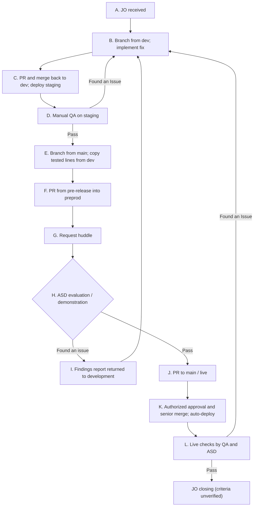

# Implementation Workflow

**Status:** Draft

This sequence describes feature/change delivery for a [JO [1]](../glossary.md#1-jo). System-specific details and other request types still need confirmation.

## Workflow

## Delivery steps

| Step | What happens |
| --- | --- |
| A | JO enters [ITD [3]](../glossary.md#3-itd) delivery path |
| B | Developer branches from dev and implements the fix |
| C | PR merged back into [Dev [17]](../glossary.md#17-dev); [staging [18]](../glossary.md#18-staging) deployed |
| D | [QA [12]](../glossary.md#12-qa) member performs manual QA; issues return to development |
| E | [Pre-release [20]](../glossary.md#20-pre-release) branch created from main; selected tested lines manually copied from dev |
| F | [PR [14]](../glossary.md#14-pr) to [preprod [19]](../glossary.md#19-preprod) branch, preprod deployment |
| G | [Huddle [21]](../glossary.md#21-huddle) requested |
| H | [ASD [6]](../glossary.md#6-asd) evaluates expected behavior and tests demo |
| I | Failed evaluation produces findings and rework; loop to B |
| J | Accepted changes proceed via PR to main |
| K | PR approved by authorized person, merged by senior; deployment automated |
| L | QA member and ASD check production; issues return to development |

## Delivery responsibilities

| Role | Involvement |
| --- | --- |
| [IT [4]](../glossary.md#4-it) developer | Implements JO changes in a fix branch; opens a PR back to dev |
| [QA [12]](../glossary.md#12-qa) member | Performs manual [staging [18]](../glossary.md#18-staging) QA; participates in live checks |
| [ASD [6]](../glossary.md#6-asd) evaluators / testers | Attend demonstrations, evaluate changes, retest, participate in production validation |
| Authorized [PR [14]](../glossary.md#14-pr) approver | Approves production-targeting PR (REPORTED, role title not verified) |
| Senior developer / merge owner | Performs merge leading to live deployment (REPORTED) |

These are reported responsibilities, not an approved responsibility or escalation matrix.

## Other request types

The delivery path for client extraction, [purging [11]](../glossary.md#11-purging), [renorming [9]](../glossary.md#9-renorming), and [decommissioning [10]](../glossary.md#10-decommissioning) still needs confirmation.
