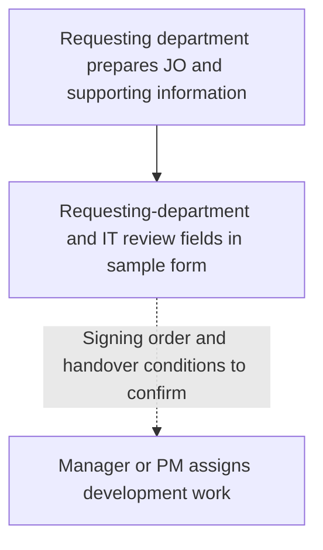

# Job Order Creation

**Status:** Draft — preparation and approval details still need confirmation.

The requesting department prepares the [JO [1]](../glossary.md#1-jo) and supporting information. The sample form includes requesting-department signatories and an IT reviewer; their exact authority and signing order are not yet established.

## Preparation and handover

The manager or [PM [5]](../glossary.md#5-pm) distributes work in meetings or direct messages. Microsoft Planner is used for tracking. Continue with the [implementation workflow](implementation-workflow.md) for delivery.

## Details to verify

- Which requests require a JO and who checks completeness.
- Required information and signatures, signing order, and when work may start.
- Decision rights of requesting-department managers/directors and the IT manager.
- Who sets priority, scope, effort, deadlines, and capacity, and who can assign work.
- Planner properties, workflow states, ownership, and deadline source.
- Authority for client data extraction/deletion, scope changes, and emergency approval bypasses.
