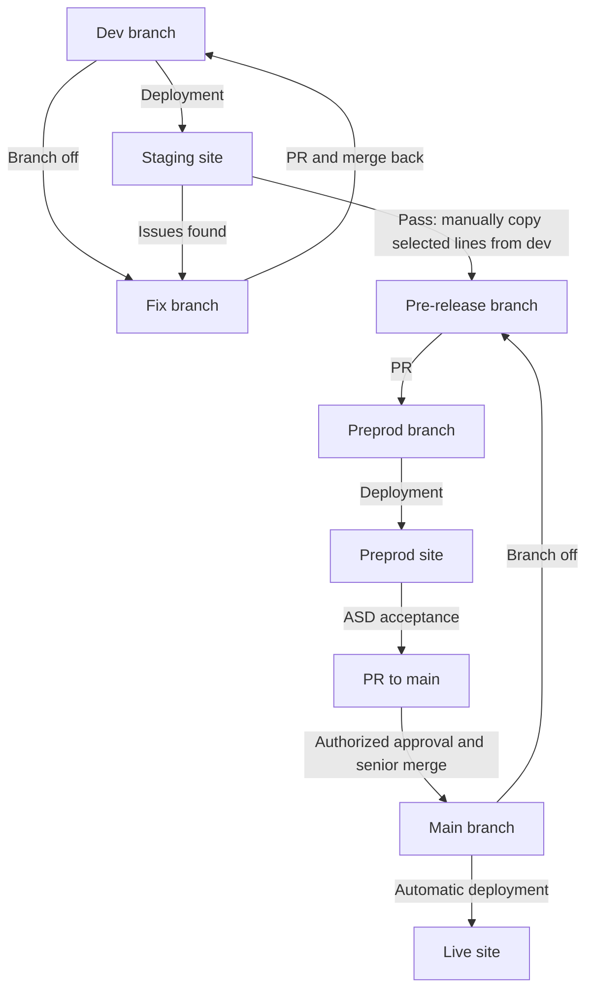

# Version Control Practice

**Status:** Draft — describes the reported branch and PR flow.

## Branch flow

## Working with changes

| Stage | What happens |
| --- | --- |
| Development | Branch from [Dev [17]](../glossary.md#17-dev) to implement the fix. Open a PR back to dev; after merge, test on the staging site deployed from dev. Issues return to the fix branch and through another PR to dev. |
| Change selection | Create a [pre-release [20]](../glossary.md#20-pre-release) branch from main. Manually copy/edit the selected, staging-tested code lines from dev into it. |
| Preproduction | A [PR [14]](../glossary.md#14-pr) proposes those changes for [preprod [19]](../glossary.md#19-preprod). |
| Production | After [ASD [6]](../glossary.md#6-asd) acceptance, a PR targets main. An authorized person approves, a senior merges, and deployment is automatic. |

For QA, huddles, live checks, and closure, see the [implementation workflow](implementation-workflow.md).
