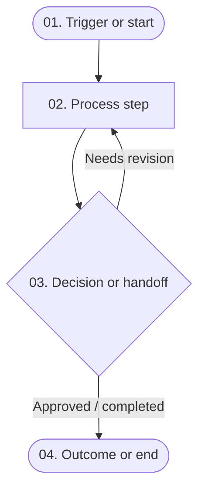

# [SOP title]

Template preview only. Replace bracketed prompts with process-owner-approved information before publication. Do not treat this template as an approved operating procedure.

## Document details

| Field         | Entry                |
| ------------- | -------------------- |
| Document ID   | [Assign document ID] |
| Version       | [Set version]        |
| Status        | [Draft / Approved]   |
| Process owner | [Department / role]  |

## Departments involved

- **Lead department:** [Enter the process-owning department]
- **Supporting departments:** [Enter participating departments, or state “None”]

## Step-by-step process diagram

[Insert the approved process diagram here. Keep its step numbers aligned with the table below.]

The following diagram illustrates the expected structure:

Replace this example with the approved process flow before publication.

## Process steps

Use the same step numbers as the diagram. Add approved actions, owners, and records for each step.

| Step | Diagram reference     | Action or decision                            | Responsible role / department | Output or record  |
| ---- | --------------------- | --------------------------------------------- | ----------------------------- | ----------------- |
| 01   | [Trigger or start]    | [Describe the approved step]                  | [Role / department]           | [Output / record] |
| 02   | [Process step]        | [Describe the approved step]                  | [Role / department]           | [Output / record] |
| 03   | [Decision or handoff] | [Describe the decision and possible branches] | [Role / department]           | [Output / record] |
| 04   | [Outcome or end]      | [Describe the completion condition]           | [Role / department]           | [Output / record] |

## Glossary

Define terms and abbreviations used in this SOP. Leave the section empty or mark it “Not applicable” when no terms need explanation.

| Term                   | Definition                   | Related step                   |
| ---------------------- | ---------------------------- | ------------------------------ |
| [Term or abbreviation] | [Write a concise definition] | [Step number / not applicable] |
